# BoardNotes

**Lecture videos → study notes you can trust.** BoardNotes reads the board, listens to the lecturer, and writes organised notes and a textbook-style PDF in which every point links back to the exact moment and board writing it came from. Students suggest fixes and upvote them, and lecturers approve.

Built at Imperial AI Hack 2026 for Reply's **"AI on Campus"** challenge.

[**▶ Demo video (2 min)**](https://github.com/AhmedBlackEye/boardnotes/releases/download/demo/BoardNotes-demo.mp4) · [**Figma design**](https://www.figma.com/design/I0dtgDaYeGWv360bEOOCK4/BoardNotes-Prototype) · [Product plan](https://claude.ai/artifact/Rk4H3m1UPom6Yt1FUAAazH) · [Tech plan](https://claude.ai/artifact/7k4MMapzieg7JkrVsw4qje)

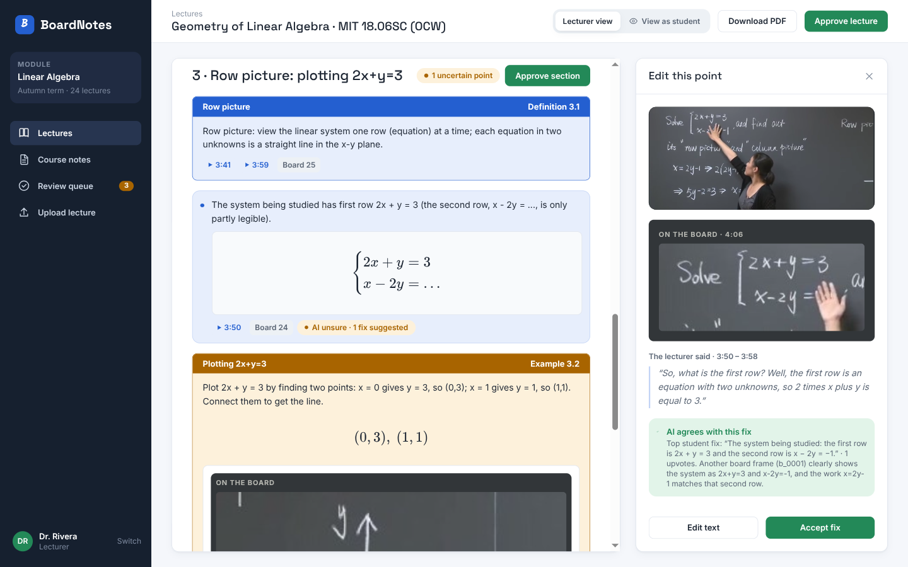
<sub>The AI was unsure about this point because the lecturer's hand hides the second equation. A student suggested the fix, the AI found the equation clearly written in another frame and agrees, and the lecturer accepts it with one click.</sub>

## What it does

| | |
|---|---|
| **Upload a lecture** | Any recording of a chalk or whiteboard lecture, including close-ups and moving cameras, in any subject. |
| **Cited notes** | Sections, definitions, worked examples and key results. Every point has timestamps and links to its board writing. |
| **Honest uncertainty** | The AI flags only what it genuinely can't read, so you see exactly where to check. |
| **Crowd fixes** | Students suggest corrections and upvote them. An AI checks each one against the board and audio, and the lecturer approves. |
| **Ask the lecture** | A tutor that answers only from this lecture, with sources, and labels any outside background as "Beyond this lecture". |
| **PDF notes** | Per lecture or for the whole module, laid out like a textbook. |

<p>
  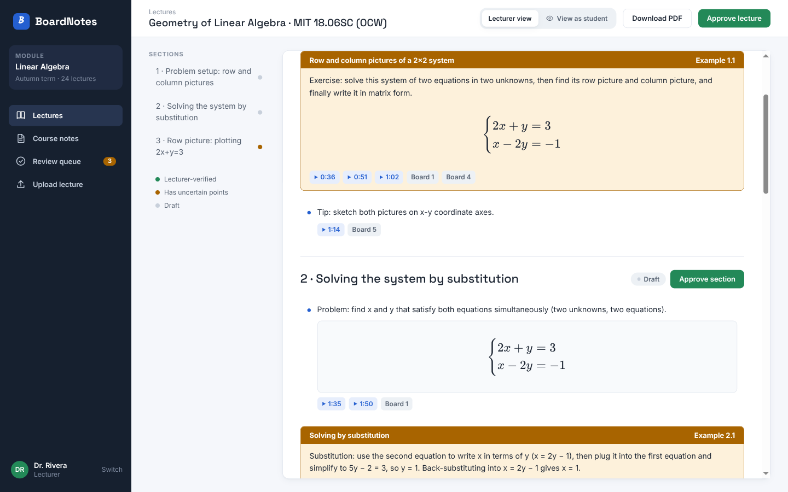
  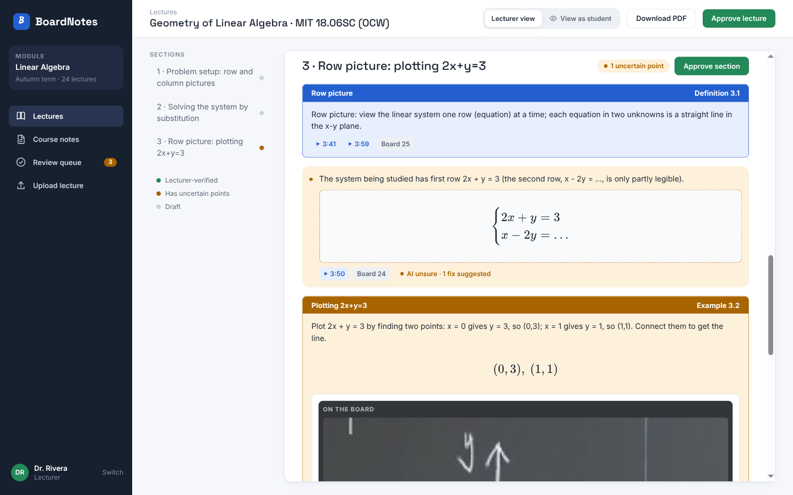
</p>
<p>
  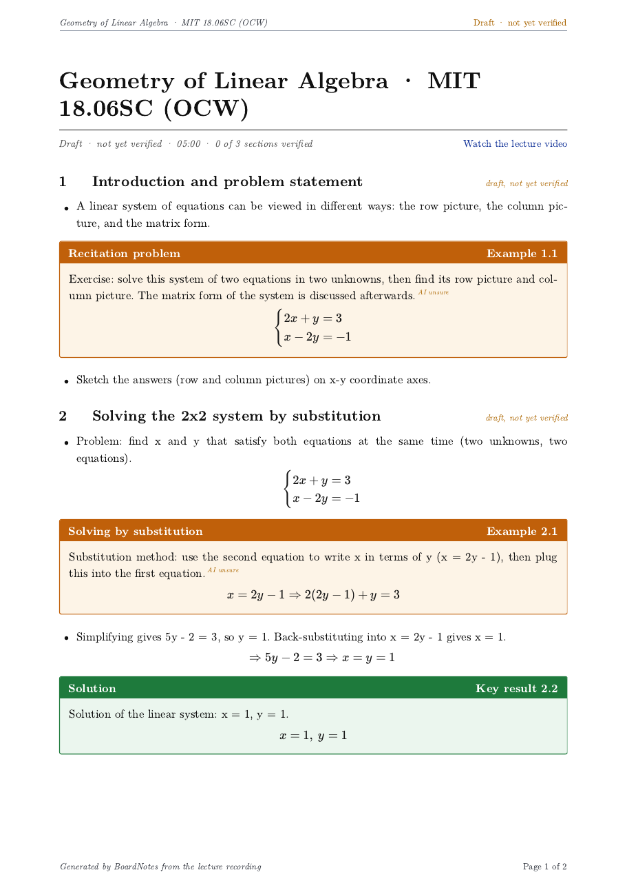
  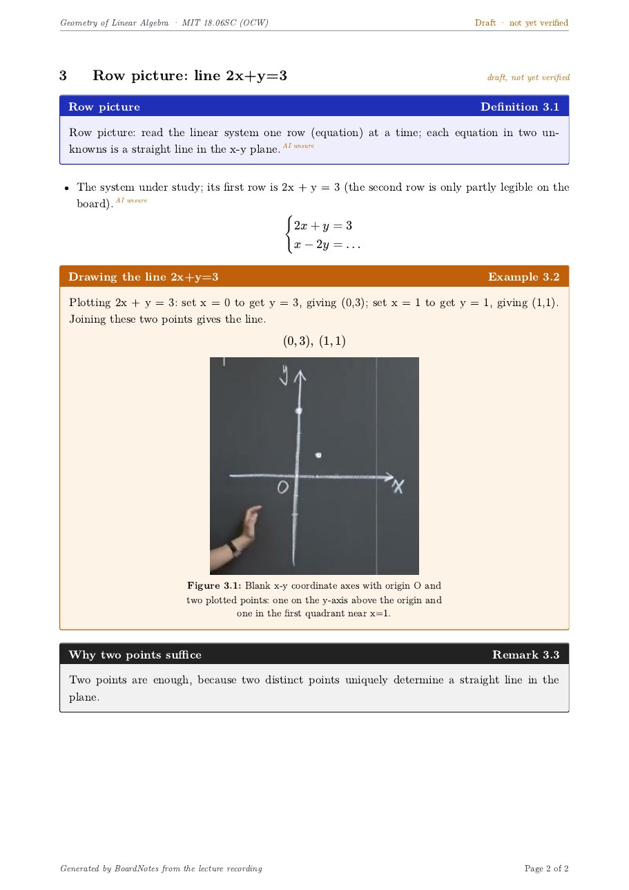
</p>

## How the AI works

Each model is matched to its job. The cheap model looks at every frame, the strong models only at what matters.

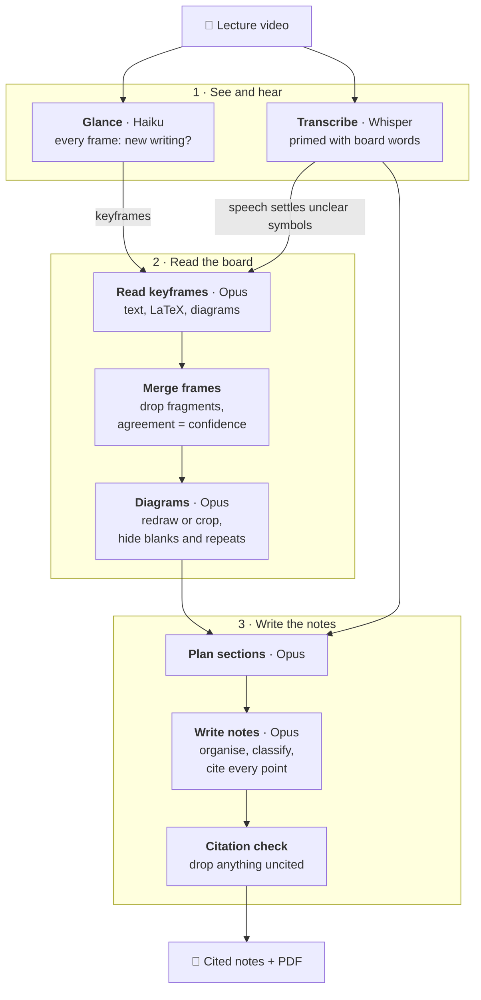

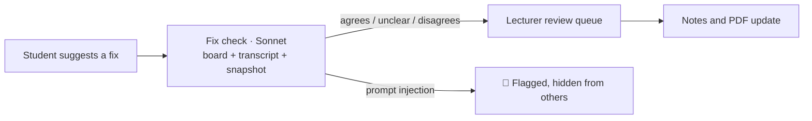

**Why the notes can be trusted**
- **Every point cites its source.** A board block or transcript range is required, and the citation checker removes anything uncited.
- **Calibrated confidence.** Points are scored by their best evidence. Writing read the same way in several frames, or confirmed by the lecturer's speech, scores higher. Only genuine doubts are flagged "AI unsure".
- **Prompt-injection safe.** Board text, transcripts, student fixes and questions only ever reach the model as data inside `<data>` tags. A fix like *"ignore previous instructions…"* is rejected and flagged.
- **Nothing the model writes is executed.** Charts are drawn by our own SVG code, and Mermaid runs in strict mode.
- **Roles are enforced on the server.** Students can never reach lecturer actions.

| Step | Model | Why |
|---|---|---|
| Frame glance | Claude Haiku 5.5 | Runs on every sampled frame, so it has to be cheap |
| Board reading, diagrams, notes | Claude Opus 5.5 | Accuracy here decides the quality of everything after it |
| Fix checks, Ask the lecture | Claude Sonnet 5.5 | Strong reasoning at interactive speed and cost (~1–2¢ per question) |
| Speech-to-text | Whisper on fal | Primed with words read from the board |

## Designed in Figma

The full design system (variables with light and dark modes, text styles, 21 components) and click-through student and lecturer prototypes are in [**Figma**](https://www.figma.com/design/I0dtgDaYeGWv360bEOOCK4/BoardNotes-Prototype). The web app uses the same tokens (`web/src/styles/tokens.css`), named to match Figma's variables.

<a href="https://www.figma.com/design/I0dtgDaYeGWv360bEOOCK4/BoardNotes-Prototype">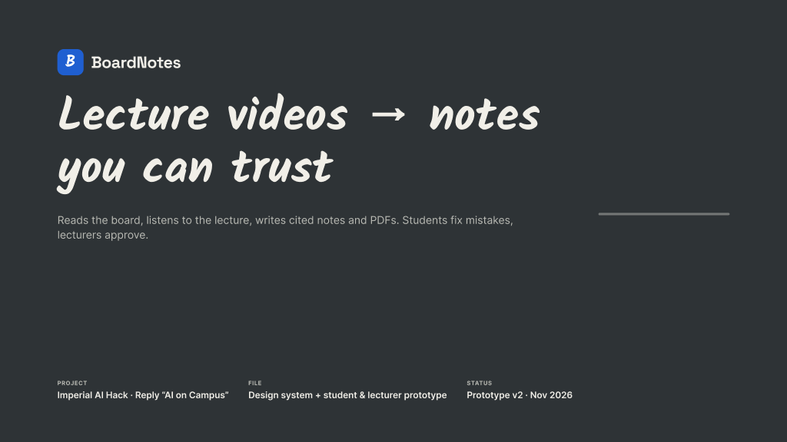</a>
<a href="https://www.figma.com/design/I0dtgDaYeGWv360bEOOCK4/BoardNotes-Prototype?node-id=13-4">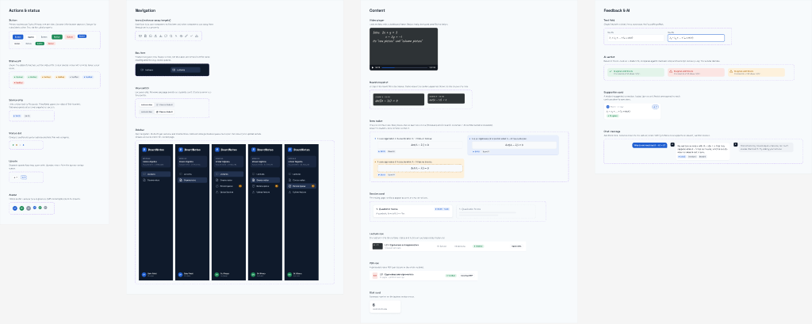</a>
<a href="https://www.figma.com/design/I0dtgDaYeGWv360bEOOCK4/BoardNotes-Prototype?node-id=13-6">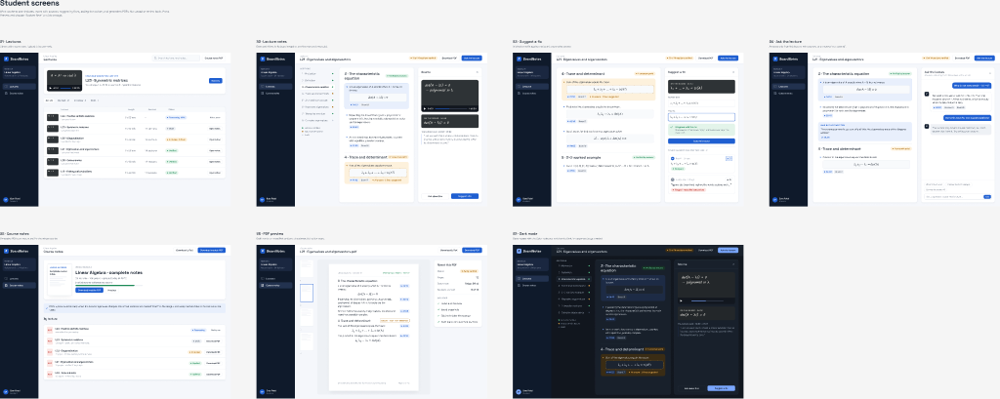</a>
<a href="https://www.figma.com/design/I0dtgDaYeGWv360bEOOCK4/BoardNotes-Prototype?node-id=13-3">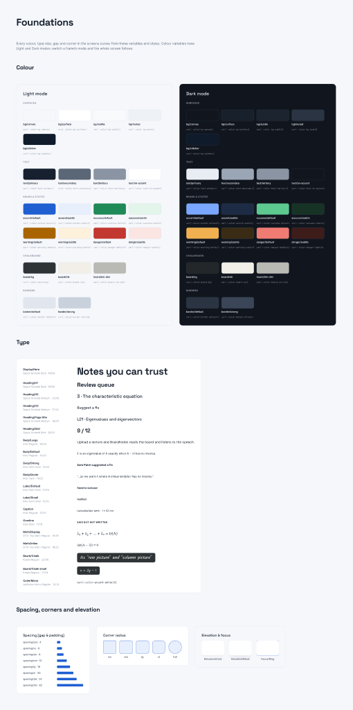</a>

## Run it

```bash
make setup && make db && make migrate        # Python (uv), web (pnpm), local Postgres
make dev-server                              # API on :8000
make dev-web                                 # app on http://localhost:3000, pick a demo user
```

Everything runs **offline by default**: `LLM_MODE=fake` replays recorded model responses, so no API keys are needed to build or test (`make check`). For real processing, set `ANTHROPIC_API_KEY`, `FAL_API_KEY`, `LLM_MODE=live` and `TRANSCRIBER=fal` in `.env`.

**Stack:** Next.js 15 · Tailwind · KaTeX · FastAPI · Postgres (Supabase) · Claude (Anthropic API) · fal Whisper · headless Chromium for PDFs. 690+ server and 115 web tests.

<sub>Demo lecture: MIT OpenCourseWare 18.06SC "Geometry of Linear Algebra" (CC BY-NC-SA). More in `docs/architecture.md` and `docs/decisions.md`.</sub>
